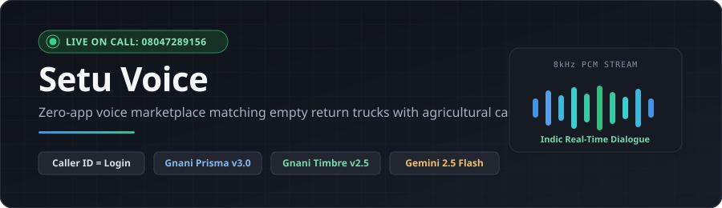
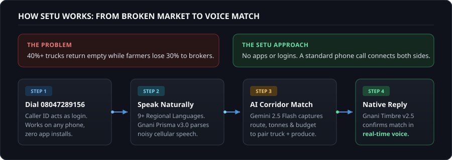
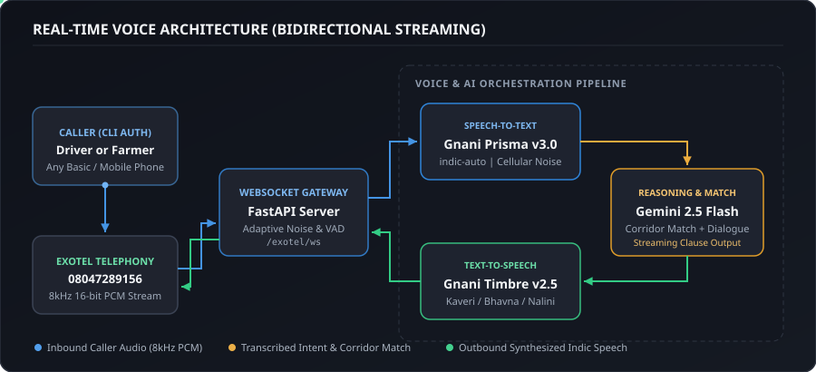

  

<h3 align="center">Zero-App, Voice-First Return-Freight Exchange</h3>

  Connecting empty return trucks with agricultural cargo over a standard phone call. 
  Built by <strong>Varshith Kumar Anand</strong> and teammate for the <strong>Great Indian AI Internship Challenge</strong>.

---

## Test the Live Deployment

Dial **`08047289156`** from any basic phone or smartphone to talk directly with the live voice agent.

> **The phone call itself is the login.** No app downloads, no OTP forms, no typing. Your Caller ID automatically identifies your profile.

| Role | Language | Sample Call Phrase |
| :--- | :--- | :--- |
| **Truck Driver** | Kannada | *"Nanna gaadi Bengaluru ge hogbeku, 10 tonne capacity ide."* |
| **Farmer / Shipper** | Hindi | *"Mujhe Pune 5 tonne pyaaz bhejna hai, kiraya 12000 rupaye."* |
| **Driver / Shipper** | English | *"I have an empty 10-tonne truck heading to Hubballi."* |

---

## How Setu Works

Over 40% of commercial trucks return completely empty from wholesale agricultural markets, while farmers lose up to 30% of their produce margins to transport brokers. Setu eliminates both inefficiencies in a single natural voice conversation.

  

---

## Visual System Architecture

Setu streams live 8kHz cellular PCM audio over bidirectional WebSockets between Exotel and our AI voice pipeline:

  

---

## Core Models & Pipeline

| Component | Model / Service | Role in Setu |
| :--- | :--- | :--- |
| **Telephony Gateway** | **Exotel AgentStream** | Streams bidirectional 8kHz 16-bit PCM audio over WebSockets (`/exotel/ws`). |
| **Speech-to-Text (STT)** | **Gnani Prisma v3.0** (`prisma-v3.0`) | Transcribes noisy mobile calls in real time across Kannada, Hindi, Telugu, Tamil, Marathi, and English (`indic-auto`). |
| **Conversational Brain** | **Gemini 2.5 Flash** | Extracts route, cargo, tonnage, and pricing while matching empty trucks with waiting harvest. |
| **Text-to-Speech (TTS)** | **Gnani Timbre v2.5** (`timbre-v2.5`) | Synthesizes natural regional voices (*Kaveri* for Kannada, *Bhavna* for Hindi, *Nalini* for English). |
